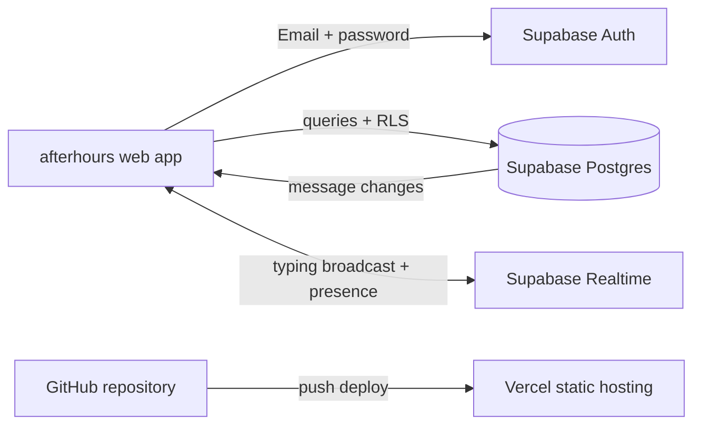

# afterhours

A small real-time room chat built with a static frontend and Supabase. The browser talks directly to Supabase Auth, Postgres, and Realtime; there is no custom application server.

## Architecture



## Run locally

1. Create a Supabase project on the free tier.
2. Open **SQL Editor** in Supabase and run [`supabase/schema.sql`](supabase/schema.sql).
3. Under **Authentication → Providers → Email**, keep email/password sign-in enabled. Leave email confirmation enabled so new accounts verify their address.
4. Under **Authentication → URL Configuration**, set the Site URL to your local origin. Add these URLs to the redirect allow list: `http://localhost:4173/**`, `http://localhost:4173/reset-password.html`, `https://your-site.vercel.app/**`, and `https://your-site.vercel.app/reset-password.html` (replace the example domain after deployment).
5. Copy the Project URL and anon/public key from **Project Settings → API** into [`config.js`](config.js). The anon key is intended for browser use; never put a service-role key here.
6. Serve the project directory with any static server. With Python installed:

   ```powershell
   python -m http.server 4173
   ```

7. Open `http://localhost:4173`, create an account with your email, mobile number, username, and password, and confirm the address from your email. Sign in and create a room. Open the site in a second browser window with another account to try live chat.

The mobile number and username are stored as Supabase Auth user metadata. The mobile number is collected but not SMS-verified. The login screen locks that email after five incorrect-password responses in the current browser and offers password reset. This browser-side counter is a usability guard, not a security boundary: clearing browser storage or using another browser bypasses it. For a strict cross-device five-attempt lockout, add a server-side rate limiter, such as a Supabase Edge Function, in front of password sign-in.

Password recovery uses Supabase Auth email delivery and returns to `reset-password.html`. Supabase's default email sender is for trying out the flow and has tight rate limits; configure SMTP in Supabase for dependable delivery.

## Deploy on Vercel

1. Push this folder to a GitHub repository.
2. Import the repository in Vercel. No build command is required; set the output directory to `.` (or leave the static project default).
3. After the first deployment, add the Vercel URL to Supabase's allowed redirect URLs and set it as the Site URL. Update `config.js` with the same Supabase project credentials, commit, and push. Vercel redeploys each push.
4. Ensure the production reset page URL remains in Supabase's redirect allow list.

## What is protected

- Rooms and messages are only available to signed-in users. Users join a room before reading or posting there.
- Row Level Security requires every new message's `user_id` to match the authenticated user. A database trigger sets the displayed name from that user's account profile.
- Updates and deletes are limited to the message author. The UI only offers edit and delete on your own messages; the policies enforce the same rule for direct API calls.
- Message inserts/updates/deletes use Postgres Changes. Typing indicators use Realtime Broadcast, and the people list uses Realtime Presence.

## Screenshots

Add screenshots of the deployed login screen and a populated room here after configuring Supabase and deploying. The project has no hosted URL or configured credentials yet.
