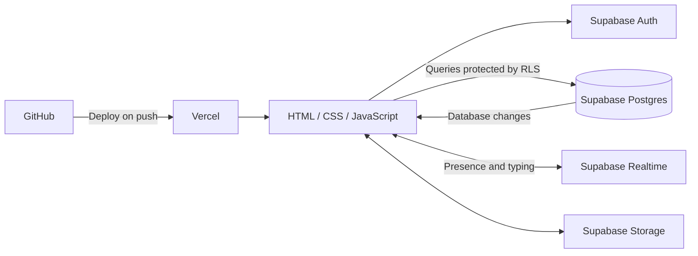

# Afterhours

Afterhours is a real-time chat website for small communities. Members can discover public rooms, join private rooms by invitation, chat with friends, and personalize their rooms and profiles.

**Live site:** [afterhours-psi-sable.vercel.app](https://afterhours-psi-sable.vercel.app)

**Repository:** [Velikan743/afterhours](https://github.com/Velikan743/afterhours)

## Features

- Email and password registration, sign-in, and password recovery
- Public room discovery and search, plus private rooms with invite links and optional expiration
- Real-time messages, typing indicators, online presence, unread counts, and unread markers
- Image and video attachments up to 20 MB, message replies, reactions, and searchable message history
- Per-room appearance themes, including **Clean** (matches the website’s selected appearance), **Midnight**, and a custom image background
- Room logos, custom emoji, and stickers
- Friends, friend requests, and private messages
- Owner and moderator tools: member roles, pins, kicks, bans, reports, ownership transfer, and moderation history
- Account profile editing, profile pictures, and website appearance choices: Default, Light, and Dark

## Technology

Afterhours uses a static frontend built with **HTML, CSS, and vanilla JavaScript**. **Supabase** provides authentication, PostgreSQL data, Row Level Security, Realtime, and file storage. **Vercel** hosts the website and deploys updates from **GitHub**. There is no separate Node/Express application server, so this is not a MERN app.



## Supabase setup

1. Create a Supabase project and open **SQL Editor**.
2. For a new database, run [`supabase/schema.sql`](supabase/schema.sql) first. For an existing database, do not rerun the base schema; apply only the feature migrations that are not already installed.
3. Apply the needed SQL files in dependency order. For the full feature set, use this sequence, skipping any migration already applied:

   1. `rooms-privacy-migration.sql`
   2. `account-settings-migration.sql`
   3. `room-customization-migration.sql`
   4. `room-read-state-migration.sql`
   5. `room-theme-variety-migration.sql`
   6. `custom-room-background-migration.sql`
   7. `room-background-size-migration.sql`
   8. `room-logo-migration.sql`
   9. `expiring-room-invites-migration.sql`
   10. `chat-media-migration.sql`
   11. `message-replies-reactions-migration.sql`
   12. `report-and-block-migration.sql`
   13. `room-owner-reports-migration.sql`
   14. `room-member-removal-migration.sql`
   15. `room-offline-members-migration.sql`
   16. `room-member-ban-kick-migration.sql`
   17. `friends-and-direct-messages-migration.sql`
   18. `fix-direct-message-and-friend-status.sql`
   19. `room-owner-details-migration.sql`
   20. `unread-message-counts-migration.sql`
   21. `room-roles-pins-mute-migration.sql`
   22. `pinned-notification-audit-migration.sql`
   23. `clean-room-theme-migration.sql`

   Some scripts explicitly depend on an earlier migration; their comments name the dependency. [`email-2fa-rollback.sql`](supabase/email-2fa-rollback.sql) is a rollback script, not part of setup.

4. In **Authentication → Providers**, enable Email and password sign-in. Email confirmation is recommended.
5. In **Authentication → URL Configuration**, set the Site URL to the production Vercel URL. Add the production website and its password-reset page to the redirect allow list, for example:

   ```text
   https://afterhours-psi-sable.vercel.app/**
   https://afterhours-psi-sable.vercel.app/reset-password.html
   ```

6. In **Project Settings → API**, copy the Project URL and publishable key (or legacy anon key) into [`config.js`](config.js), using [`config.example.js`](config.example.js) as a reference. The browser key is public by design; never put a `service_role` or other secret key in frontend files. Database access must remain protected by RLS.
7. Configure SMTP in Supabase for reliable password-recovery email delivery. The built-in sender is intended for limited testing and may be rate-limited.

## Deploy with GitHub and Vercel

1. Push the repository to GitHub.
2. In Vercel, import the GitHub repository and deploy it as a static site. No framework preset, build command, or output build directory is needed; serve the repository root.
3. Add the deployed Vercel URL to Supabase’s Site URL and redirect allow list, as described above.
4. Confirm `config.js` contains the matching Supabase Project URL and public publishable/anon key, then push the change. Vercel deploys new commits automatically.
5. After deployment, create an account and confirm its email. Test public-room discovery, private invitation links, chat, media, friends/direct messages, and password recovery.

## Security and operational notes

- Supabase Row Level Security is the access-control boundary for rooms, memberships, messages, and related data. Keep RLS enabled and review policies before adding tables or changing grants.
- The five-attempt login counter is enforced in the browser as a usability measure. It is not a security boundary: clearing browser storage or switching browsers bypasses it. Strict cross-device lockout requires server-side rate limiting in front of sign-in.
- The signup form collects a mobile number but does not verify it by SMS.
- Never commit service-role keys, SMTP passwords, or other private credentials. Only the publishable/anon key belongs in the browser configuration.

## Project files

- `index.html`, `styles.css`, `room-manager.css`, `room-discovery.css`, `account-settings.css`, `typography.css`, `site-theme.css` — application structure and styles
- `app.js`, `site-theme.js` — chat behavior and website theme selection
- `settings.html`, `settings.js` — account settings
- `reset-password.html`, `reset-password.js` — password reset flow
- `config.js` — Supabase browser configuration
- `supabase/` — base schema and incremental database migrations
